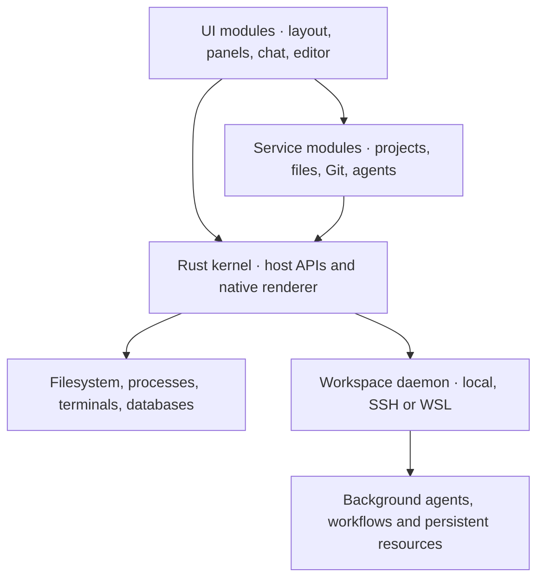

# Hato architecture

Hato is a native desktop workspace for browsing projects, editing files, reviewing changes,
running terminals and working with AI agents. A project can live on the desktop machine,
in WSL or on an SSH host. Git tasks give a project additional workspaces backed by linked
worktrees.

Hato also hosts its own application plugins. Most features and their interface are TypeScript
modules that can be rebuilt and replaced while the application runs. A Rust kernel supplies
native rendering, operating-system access, module execution and permission enforcement.

## The three layers

| Layer | Responsibility | Source |
| --- | --- | --- |
| Native kernel | Windows, controls, JavaScript runtimes, calls, resources, filesystem/process/terminal/SSH adapters, approvals and capability checks | `kernel/src/` |
| Shared SDK | TypeScript contracts and helpers bundled into the modules that use them | `sdk/` |
| Application plugins | Projects, conversations, providers, workflows, persistence schemas, settings, navigation and panel presentation | `Hato-plugins/modules/` |

The plugin checkout is a separate Git repository. Kernel and SDK changes belong to Hato.
Plugin source, package metadata and published plugin bundles belong to Hato-plugins.
Each repository has its own commits and release cycle.



## Modules and packages

A module is an independently loaded service or UI component. Its `manifest.json` declares an
ID, entry point, dependencies, callable modules, capabilities and contributions. Its bundled
JavaScript exports an `AppModule`.

A package groups related modules into an installable feature. For example, AI Chat contains
conversation services, the chat interface, MCP integration and Prompt History. Background
Agents contains the desktop gateway, agent panel and daemon-side runtime. Provider packages
add Claude, Codex, OpenCode or Copilot integration.

The plugin catalogue defines package membership, versions and dependency ranges.
Settings → Plugins installs and manages packages. The setup wizard selects an initial profile.
Default includes AI Chat, Git, Background Agents and remote workspaces, with provider choices.
Claude and Codex start selected. Full includes all available feature packages.

## How a module runs

The kernel discovers manifests, resolves dependencies and selects a saved JavaScript build.
It evaluates each module generation in a QuickJS runtime and calls `activate(ctx, snapshot)`.
The module can then expose methods, subscribe to events and state, and render UI.

Modules communicate through three contracts.

- `ctx.modules.call(target, method, args)` invokes another module's method.
- `ctx.state` publishes values that other modules can observe. Writes belong to the publishing
  module's namespace.
- `ctx.events` carries notifications and requests. Publishers own their topic namespace.

Modules access native facilities through `ctx.host`. The JavaScript bridge forwards these
operations to the Rust broker, which validates permissions, scope and resource ownership
before calling an adapter. The host API and UI node types are defined in `sdk/types.ts`.

The SDK is compiled into consumers. Changing a helper requires rebuilding every module that
imports it.

## Native UI with module-owned presentation

UI modules return `UiNode` trees. The kernel renders those trees with GPUI and native components.
Modules choose composition, labels, actions, sizes, styling and navigation. Native code implements
reusable controls, rendering and interaction mechanics.

Manifest contributions let a plugin add panels, activity items, settings and other shell elements.
`workspace-layout` composes those contributions and persists layout preferences. The sidebars
discover contributions through shared SDK helpers.

The Viewer supplies source editors, Markdown views and Git diffs. Other modules can supply
virtual documents, including read-only diff tabs. Editor buffers, terminal processes and similar
native resources use kernel-owned handles so they can survive compatible module reloads.

## Projects and execution targets

`projects` owns project registration. `workspace` resolves the selected project root or Git task
into a descriptor with its machine, location and root path. File, process and terminal operations
use that descriptor to obtain scoped access on the correct machine.

Local projects use local host adapters. SSH projects use remote file/process facilities and a
daemon on the workspace machine. Windows uses the native desktop window with projects in native
Windows folders, in WSL or on SSH hosts (native folders use a local Windows daemon for persistent
terminals and processes). Platform constraints are documented in `docs/COMPATIBILITY.md` and
`docs/WINDOWS.md`.

The headless daemon is another mode of the native executable, commonly called hatod. It runs
module services on the workspace machine and holds durable resources there. The desktop is a
client of those services.

## Chat, background agents and workflows

Regular chat follows this path.

```text
ai UI → ai-sessions → acp → provider adapter process
                  ↘ persistence
```

ACP is the Agent Client Protocol used to exchange prompts, streamed messages, tool activity,
permissions and session metadata with provider adapters. Providers advertise their capabilities.
The installed adapter and its authentication live on the machine where the agent runs.

Background agents use a separate controller.

```text
agents-panel / ai UI → persistent-agents → workspace daemon → agent-runner
                                                          → internal-remote-mcp
```

Their processes, messages and permissions live on the daemon. An accepted turn can continue when
the desktop closes or disconnects. Reconnecting the UI reads the existing session. Restarting
the daemon interrupts running work, with recovery depending on provider capabilities.

Workflows are graphs edited by `workflows-panel`. The desktop `workflows` service delegates
execution to daemon-side `workflow-runner`, which coordinates scripts, processes, agent sessions
and graph transitions. Workflow execution and durable run state stay on the workspace machine.

## Change capture and review

Prompt History combines recorded prompt/tool diffs with project changes captured by the
`files` service. Capture compares text snapshots of the selected project while Hato is running.
It checks periodically, using Git to enumerate repository files and scoped filesystem enumeration
for folders without Git. It leaves the staging index and commit history intact.

Captured edits are attached to a prompt when one active owner is known. Concurrent or
unattributed changes appear as project changes. The chat interface inserts captured diffs beside
tool activity. History rows sort by the latest recorded activity.

Settings → Change history controls capture, history panel/sidebar visibility and inline chat
diffs. Retention has an age limit and a storage cap per project, with oldest records removed
first. Defaults are seven days and 20 MB. Clear history removes stored capture records.

Capture covers text files up to 200 KB, excludes dependency/cache folders and Git-ignored
untracked files, and has project-size limits. Checks can combine intermediate edits. The panel
reports capture warnings. Provider-supplied diffs remain part of the conversation transcript
and have a separate lifetime from captured-history records.

## Persistence and resources

The `persistence` service owns application SQLite schemas and migrations for projects,
conversations, settings and other application records. Daemon services own their own namespaces
for background sessions and workflow runs.

The kernel maintains module artifacts, enabled-plugin records, approvals, handles and logs.
Application data is separate from source checkouts. A hot reload changes the selected module
generation while preserving compatible snapshots and reusable native resources.

Persistent plugin state, in-memory published state and native resources have different lifetimes.
A module should use persistence for records that must survive application restarts and snapshots
for state transferred during replacement.

## Permissions and agent tools

Manifests request capabilities and module-call targets. The kernel computes effective permissions
from install bounds and approved grants, validates filesystem/process scopes and enforces handle
ownership. The trusted approval UI belongs to native code.

MCP, the Model Context Protocol, exposes application tools to agents. Internal MCP services route
workspace-bound tools to application services. Module maintenance tools inspect sources, apply
approved patches, build, stage, activate and roll back modules.

Agents can evolve the application through those tools. Native permission checks still apply to
each operation. Replacing a running daemon can interrupt its resources, so desktop plugin
updates and daemon runtime updates are separate operations.

## Builds, activation and releases

`npm run dev` builds plugins, watches module/SDK sources and launches Hato with `--dev-watch`.
Changed bundles are staged and activated by the development host. A plain module build writes
bundles, and explicit maintenance tools can stage and activate them in a running application.

Hot replacement fences a generation, transfers its snapshot, activates and checks the replacement,
then cuts over. Saved healthy artifacts provide rollback versions.

Rust changes and compiled first-party grant changes require a native rebuild and relaunch.
Compatible TypeScript changes use module activation.

Packaged applications use `plugins.lock.json` to install a pinned initial plugin set into
application data. Catalogue updates provide independently versioned plugin packages with
SHA-256-verified manifests and bundles. Publishing new plugin artifacts makes them available
through Settings → Plugins. Updating the native application and updating installed plugins
are separate release paths.

## Source map

| Path | Start here for |
| --- | --- |
| `kernel/src/kernel.rs`, `router.rs`, `artifacts.rs` | Boot, generations, calls, hot replacement and saved builds |
| `kernel/src/js/`, `ops.rs` | QuickJS bridge and trusted host operations |
| `kernel/src/grants.rs`, `approvals.rs`, `handles.rs` | Permissions, trusted decisions and resource ownership |
| `kernel/src/host/`, `daemon/`, `ui/` | OS adapters, workspace daemon and native rendering |
| `sdk/types.ts`, `runtime.ts` | Shared contracts, workspace descriptors and scoped operations |
| `Hato-plugins/modules/services/` | Application data, execution and integration logic |
| `Hato-plugins/modules/ui/` | Shell, panels, settings and user interactions |
| `Hato-plugins/plugins.catalogue.json`, `catalogue.json`, `packages/` | Package definitions and published artifacts |
| `tools/`, `tests/`, `Hato-plugins/tests/` | Build/release tools and verification |

For feature details, see [plugins](docs/PLUGINS.md), [plugin runtime and releases](docs/PLUGIN_RUNTIME.md),
[background agents](docs/PERSISTENT_AGENTS.md), [workflows](docs/WORKFLOWS.md),
[settings](docs/SETTINGS.md) and [testing](docs/TESTING.md).
